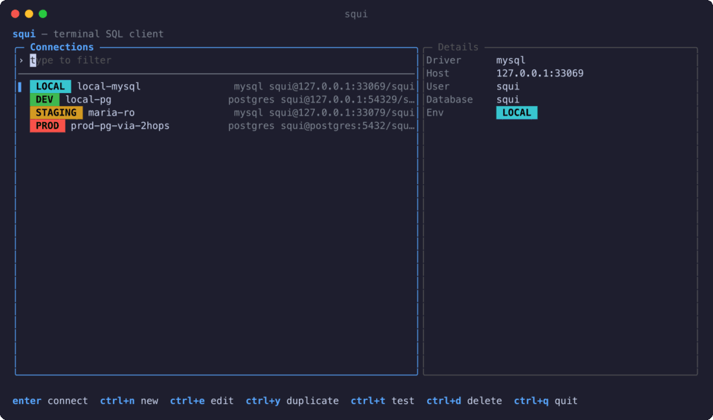

<h1 align="center">squi</h1>

<p align="center">
  <strong>A fast, keyboard-driven SQL client for your terminal.</strong><br>
  PostgreSQL · MySQL · MariaDB · ClickHouse — over SSH, safe on production, one small binary.
</p>

<p align="center">
  <a href="https://github.com/farvisun/squi/actions/workflows/ci.yml"></a>
  <a href="https://github.com/farvisun/squi/releases/latest"></a>
  <a href="go.mod"></a>
  <a href="LICENSE"></a>
</p>

<p align="center">
  
</p>

## Why squi

A DataGrip-style workflow without the weight: browse schemas, write SQL with
completion, edit rows, and inspect plans — all from the terminal, locally or on a
server you reached over SSH.

- **Explore** databases, schemas, tables, views and routines; see columns, indexes,
  foreign keys, triggers, sizes and generated DDL.
- **Query** in tabs with syntax highlighting, vim or standard keys, context-aware
  autocomplete, history and snippets. Run with `ctrl+enter`.
- **Browse results** in a streaming grid: lazy loading, sort, filter, cell inspector,
  copy as CSV / JSON / INSERT / Markdown.
- **Edit data inline** — review the generated SQL, applied in one transaction.
- **Connect through SSH** bastions, `~/.ssh/config` aliases and `ProxyJump` chains,
  with no local ports opened. Passwords live in the OS keychain.
- **Stay safe on production**: read-only connections, typed confirmation for
  destructive statements, a red status bar on `prod`, manual transactions.
- **Import / export** CSV, TSV, JSON, SQL; **EXPLAIN** as a plan tree; **admin views**
  for sessions, variables, users and sizes.
- **ClickHouse** over its HTTP interface — engines, sorting and partition keys,
  skipping indexes, parts and `EXPLAIN indexes = 1` included.
- **Pick up where you left off** — tabs and queries are restored on the next start.

## Install

| Platform | Command |
|---|---|
| macOS / Linux (Homebrew) | `brew install farvisun/tap/squi` |
| Windows (Scoop) | `scoop bucket add farvisun https://github.com/farvisun/scoop-bucket` then `scoop install squi` |
| Debian / Ubuntu | download the `.deb` from [Releases](https://github.com/farvisun/squi/releases/latest), then `sudo apt install ./squi_*.deb` |
| Fedora / RHEL / Alpine | `.rpm` and `.apk` packages on the [Releases](https://github.com/farvisun/squi/releases/latest) page |
| Go 1.26+ | `go install github.com/farvisun/squi/cmd/squi@latest` |
| From source | `git clone https://github.com/farvisun/squi && cd squi && make install` |

## Quick start

```sh
squi                    # open the connection manager
squi --connect prod-api # jump straight into a saved connection
```

Press `ctrl+n` to add a connection, `ctrl+t` to test it, `ctrl+s` to save, then
`enter` to connect. Write SQL and press `ctrl+enter` (or `F5`).

| Keys | Action |
|---|---|
| `F1` / `?` | Help — every key binding |
| `ctrl+p` | Command palette |
| `ctrl+enter` · `F5` | Run statement under cursor |
| `ctrl+t` · `alt+1…9` | New tab · switch tab |
| `tab` | Move between explorer, editor and results |
| `ctrl+g` | Transaction menu |
| `ctrl+q` | Quit |

See the **[user guide](docs/USAGE.md)** for configuration, SSH setup, the safety model
and the full key reference.

## Development

```sh
make dev-up   # Postgres, MySQL, MariaDB, ClickHouse and SSH bastions in Docker
make dev      # run squi against them
make test-integration
```

Contributions are welcome — please open an issue to discuss larger changes first.

## License

[MIT](LICENSE)
